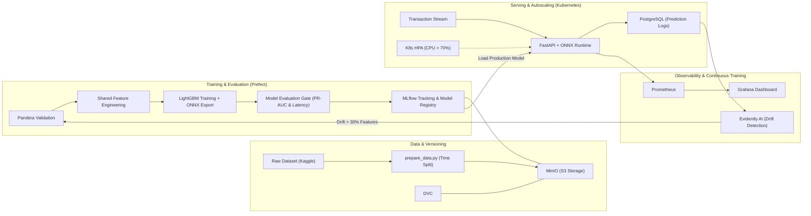

# FraudGuard MLOps

An end-to-end, production-grade **Real-Time Credit Card Fraud Detection** MLOps system designed to run locally at **$0 cloud cost** using Docker Compose and local Kubernetes.

This project demonstrates how to jointly version and automate **Code**, **Data**, and **Models** across the full ML lifecycle: data validation, experiment tracking, model registry, gated promotion, CI/CD, low-latency ONNX serving, autoscaling, observability, and closed-loop drift-triggered retraining.

---

## Architecture Overview



---

## Tech Stack

| Layer | Local Stack | Cloud Equivalent | Role |
| :--- | :--- | :--- | :--- |
| **Object Storage** | MinIO | Amazon S3 / GCS | Stores DVC datasets and MLflow model artifacts |
| **Database** | PostgreSQL + SQLAlchemy | Amazon RDS | Stores MLflow/Prefect metadata and real-time prediction logs |
| **Data & Model Versioning** | DVC + MLflow | SageMaker Registry | Versions dataset snapshots and manages model stages (`Staging` → `Production`) |
| **Data Validation** | Pandera | AWS Glue DataBrew | Enforces schema, types, and value constraints before train and serve |
| **Orchestration & CI/CD** | Prefect + GitHub Actions | Airflow + AWS CodePipeline | Automates linting, tests, training flows, and container builds |
| **Model Serving** | FastAPI + ONNX Runtime | Triton / SageMaker Endpoints | Serves real-time predictions with target p95 latency < 30 ms |
| **Orchestration Runtime** | Docker Compose + Kind/Minikube | AWS EKS / GKE | Containerizes services and autoscales API pods with HPA |
| **Observability** | Prometheus + Grafana + Evidently AI | CloudWatch + Arize AI | Tracks API golden signals and detects data drift to trigger retraining |

---

## Project Structure

```text
.
├── .github/workflows/          # GitHub Actions CI/CD pipelines (lint, test, build)
├── configs/                    # Hyperparameters, drift thresholds, environment configs
├── data/                       # Local data directory (raw/processed gitignored; .dvc tracked)
├── infra/
│   ├── k8s/                    # Kubernetes manifests (Deployment, Service, HPA)
│   └── monitoring/             # Prometheus config and Grafana dashboard JSON
├── pipelines/                  # Prefect orchestration flows (training & drift monitoring)
├── scripts/
│   └── prepare_data.py         # Chronological data splitting and controlled drift injection
├── src/
│   ├── data_validation/        # Pandera data schemas
│   ├── features/               # Shared feature engineering logic (train & serve)
│   ├── models/                 # LightGBM training, evaluation gate, and ONNX export
│   └── serving/                # FastAPI app, Pydantic schemas, PostgreSQL logging
├── tests/                      # Unit and integration tests (pytest)
├── Makefile                    # Standardized developer & ops commands
├── pyproject.toml              # Project metadata and dependencies
└── uv.lock                     # Locked dependency graph for reproducibility
```

---

## Quickstart

### Prerequisites
* Python `3.11` (managed via [`uv`](https://docs.astral.sh/uv/))
* Docker Desktop (for upcoming container & orchestration stages)
* GNU Make (optional, for running `Makefile` shortcuts)

### 1. Install Dependencies
```bash
uv sync --frozen
```

### 2. Prepare Time-Ordered Datasets
Download the **Credit Card Fraud Detection** dataset (`creditcard.csv`) from Kaggle into `data/raw/creditcard.csv`, then run:

```bash
uv run python scripts/prepare_data.py --input data/raw/creditcard.csv --output-dir data/processed --seed 42
```

This chronologically splits the 284,807 transactions into three Parquet datasets to avoid temporal data leakage:

| Split | Rows | Fraud Rate (%) | Night Rate (%) | Mean Amount | Median Amount | Purpose |
| :--- | ---: | ---: | ---: | ---: | ---: | :--- |
| `transactions_v1.parquet` | 113,922 | 0.21% | 9.36% | 95.10 | 25.00 | Initial baseline training (first 40%) |
| `transactions_v2.parquet` | 113,923 | 0.15% | 9.03% | 86.55 | 21.23 | Data version `v2.0` retraining (next 40%) |
| `transactions_drift_v3.parquet` | 56,962 | 0.13% | 60.00% | 197.27 | 47.50 | Simulated production stream with drift (last 20%) |

### 3. Run Code Quality Checks & Tests
```bash
make lint   # uv run ruff check .
make test   # uv run pytest
```

---

## Benchmarks

> Updated incrementally as optimization and load-testing stages are completed.

| Metric | Baseline | Optimized | Target | Status |
| :--- | :--- | :--- | :--- | :--- |
| Model Quality (PR-AUC) | _TBD (Week 1)_ | _TBD (Week 4)_ | > 0.80 | Pending |
| Serving Docker Image Size | _TBD (Week 2)_ | _TBD (Week 2)_ | < 400 MB | Pending |
| Inference p95 Latency (500 VUs) | _TBD (Week 6)_ | _TBD (Week 6)_ | < 30 ms | Pending |
| K8s HPA Autoscaling | 2 Pods | _TBD (Week 6)_ | Auto-scale to 4 Pods at CPU > 70% | Pending |

---

## Implementation Roadmap

- [x] **Stage 0 — Setup & Foundations:** Project scaffolding, `uv` (Python 3.11), `Makefile`, chronological Parquet data pipeline with reproducible drift injection.
- [ ] **Week 1 — Validation & Baseline Model:** Pandera schemas, shared feature engineering, LightGBM baseline (`PR-AUC > 0.80`), `pytest` suite.
- [ ] **Week 2 — Inference API & Docker:** FastAPI + Pydantic (`/predict`, `/health`), PostgreSQL prediction logging via SQLAlchemy, multi-stage `Dockerfile.serve` (`< 400 MB`).
- [ ] **Week 3 — Experiment Tracking & Registry:** MinIO + MLflow Tracking Server, Model Registry (`Staging` → `Production`), dynamic model loading in FastAPI.
- [ ] **Week 4 — Data Versioning & Evaluation Gate:** DVC remote on MinIO (`v1.0` / `v2.0`), automated Model Evaluation Gate comparing PR-AUC and latency.
- [ ] **Week 5 — Orchestration & CI/CD:** End-to-end Prefect training flow, GitHub Actions workflow (`Ruff`, `pytest`, Docker build & push to GHCR).
- [ ] **Week 6 — ONNX Runtime & Kubernetes:** LightGBM → ONNX conversion, Locust load testing (500 virtual users), local Kubernetes deployment with HPA.
- [ ] **Week 7 — Observability:** Prometheus metrics instrumentation (`p50`/`p95`/`p99`, HTTP errors, fraud prediction rate) and real-time Grafana dashboard.
- [ ] **Week 8 — Drift Detection & Continuous Training:** Evidently AI monitoring flow on PostgreSQL logs with automatic retraining when > 30% key features drift.
